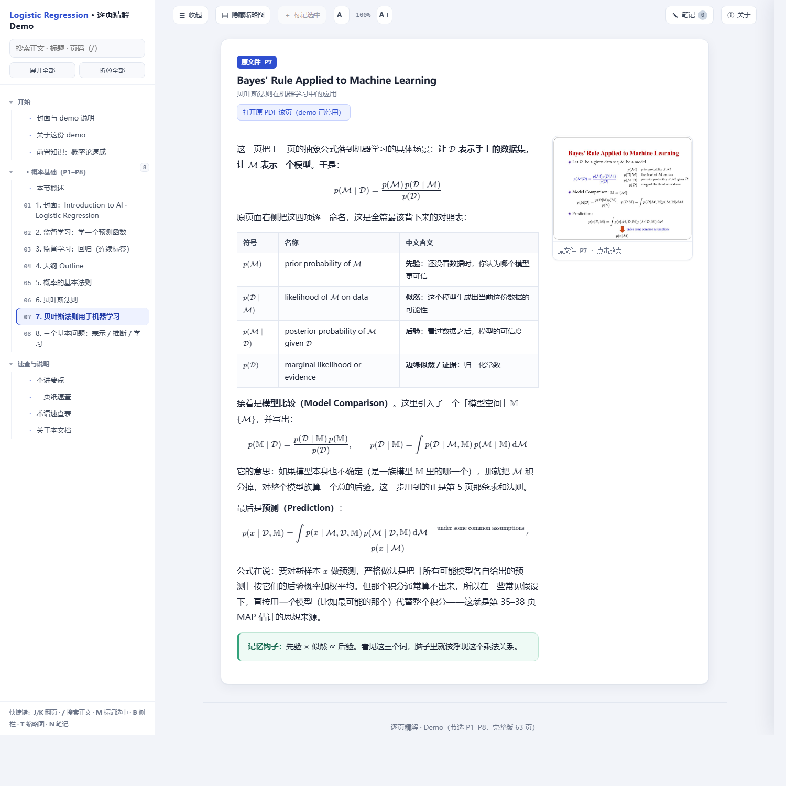
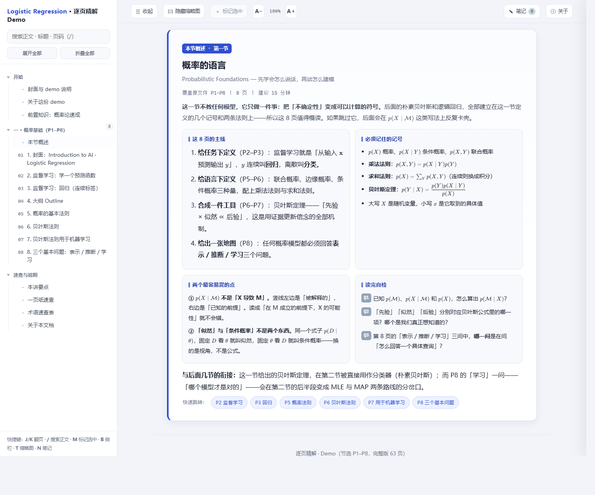
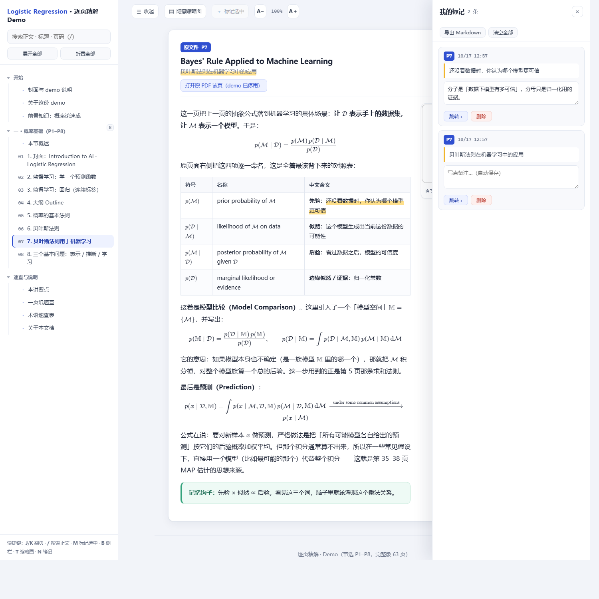
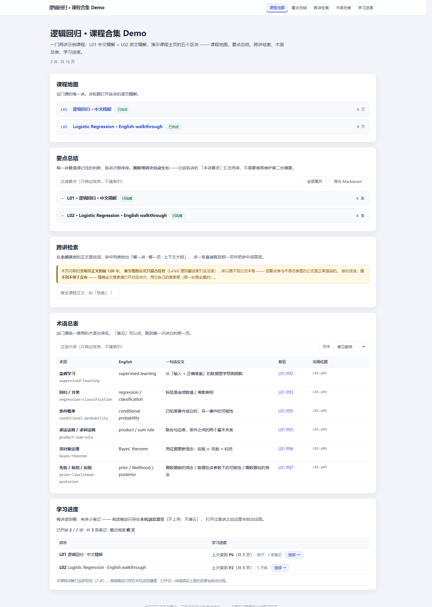

English ｜ [简体中文](README.md)

# pdf-slides-annotated-html

> Turn lecture PDFs into a **single-file HTML** with complete per-page explanations sitting next to the original slides: thumbnail cross-reference, offline formula rendering, collapsible TOC, text highlighting with a notes drawer — fully offline.
> The explanations are **written by an AI agent**: hand it your deck, get a finished document in one conversation. You can also run everything yourself.

**▶ [Try the live demo](https://zzzhen-22.github.io/slides-annotated-html/demo-en/)** — an 8-page interactive excerpt, **fully in English**. Nothing to install: click the TOC, highlight a sentence, take a note. (The original Chinese demo lives [here](https://zzzhen-22.github.io/slides-annotated-html/demo/).) Course-collection version: **[course homepage demo](https://zzzhen-22.github.io/slides-annotated-html/demo-course/)** — the same two demos treated as two lectures of one course, plus a course entry page (map / key points / cross-lecture search / glossary / progress).



Feed it a slide deck (a lecture PPT exported to PDF, a tech talk, training material) and it produces a self-contained `.html`:

- Explanations on the **left**, original page thumbnails on the **right** — no window switching
- Formulas rendered by **KaTeX, fully offline** (fonts embedded as data URIs)
- Six interactions: collapsible TOC / per-section overview cards / thumbnails auto-enlarge when the sidebar collapses / **highlight text → notes drawer** / **A− / A＋ to adjust body text size (level saved in your browser)** / **full-text search over the body (hit list with jump & highlight, not just a title filter)**
- An in-page **About** panel in the top bar: usage guide (how to read, take notes, jump back) plus a link to the generating tool on GitHub — the long “how to use” card is gone from the body, and the old “source PDF embedded” one-liner moved here too.
- **Code blocks**: syntax colouring (comments / strings / keywords / numbers — applied at build time, **no highlighting library**), a header showing the language and source, and **one-click copy** (what lands on the clipboard is plain code, without the colouring markup)
- Clearly separates "what the original says" from "what the explainer added" (green = intuition, blue = added derivation, red = source issue, gray = quotation)
- Optionally **embed the original PDF** (base64) so page-deep links survive across devices

<p align="center">
  
  
</p>

> **Where the quality comes from:** text layers of slide-exported PDFs are unreliable — math glyphs are frequently mis-mapped, so trusting them guarantees wrong explanations. The pipeline therefore *forbids* skipping page-by-page image reading, for agents and humans alike. Everything mechanical (skeleton, rendering, assembly, checks, screenshots) is automated; the per-page explanations are written by the agent — your job is a final review, not typing page by page.

---

## Let an AI do it (recommended)

This repository *is* an Agent Skill: `SKILL.md` contains complete, executable instructions for an AI agent — how to clarify requirements, how to read each rendered page and write explanations, how to verify before delivery.

**WorkBuddy**: drop the repo into `~/.workbuddy/skills/pdf-slides-annotated-html/`, then just ask: *"Turn this lecture PDF into an annotated HTML."*
The agent will self-check the environment, draft a section outline from the deck, **confirm the structure with you**, build the skeleton from that outline, **read every rendered page and write the explanations**, re-check until "pending pages = 0", pass all validations and screenshots, then deliver — reporting any page it is unsure about and any problem found in the original deck.

**Other AI coding assistants**: clone the repo and hand `SKILL.md` to your agent as the task brief (Claude Code and similar tools that support the SKILL.md format can install it as a skill directly).

**After delivery, do one thing**: spot-check the paraphrasing of key formulas. The validations catch rendering and structural errors, and the annotation rules make "original" vs. "added" visually distinct — but whether a formula explanation is *semantically* correct can only be confirmed by a human eye. If a page reads wrong, point at it and let the agent rewrite.

---

## Run it yourself

The same suite in manual mode — you write the explanations instead of the agent.

### Quick start

In the repository root:

```bash
pip install -r requirements.txt                        # ① Python deps (pymupdf, pillow)
python scripts/kitpath.py                              # ② environment self-check: python / node / browser / deps
python scripts/run_all.py examples/sample-lecture.pdf --out demo   # ③ one-shot run (8-page sample deck)
```

- Step ② prints a four-item check; anything missing comes with a copy-paste fix.
- Step ③ needs Chrome / Edge for headless checks and screenshots (auto-detected, or set `KIT_BROWSER`). Node is optional — only `check_math.js` uses it, and the step is skipped if absent (see "Without Node" below).

| Dependency | Used for | Notes |
|---|---|---|
| Python 3.9+ | all scripts | see `requirements.txt`; missing packages produce a copy-paste pip command |
| Chrome / Edge | headless checks & screenshots | auto-detect: env var → PATH → common install locations |
| Node.js (optional) | `check_math.js` formula **syntax** check | the only place node is used; skipped if absent — group ⑮ of `check_ui.py` statically covers the rest |

### Without Node

Everything still runs; you lose exactly one thing — whether a formula's **syntax** is valid
KaTeX (missing arguments, unknown commands, `strict` violations). Step ④ is reported as skipped
and the pipeline continues.

Every check in `check_math.js` that does **not** need rendering is covered by group ⑮ of
`check_ui.py` (pure Python, runs with step ⑤): formula tag pairing / brace balance /
`\left`·`\right` pairing / `\begin`·`\end` pairing, HTML tag pairing, and TOC anchors.
Both checkers use the same definitions, so they agree on the same product.

`kitpath.py` lists node as an **optional** dependency — its absence does not turn the
environment self-check red.

You get: `config.json`, `content/` skeletons with TODO markers, `_extract/` page images + thumbnails, `_katex/` offline KaTeX (bundled, no download), the single-file HTML plus a per-project `README`. Step ⑦ reports **pending pages N / M — target 0**.

Re-check after editing `content/` (skips skeleton & rendering, much faster):

```bash
python scripts/run_all.py "<deck>.pdf" --out "<same dir>" --skip-init --skip-prepare
```

Prefer step by step? `prepare_pdf.py` (page images + text layer) → read `_extract/page-NN.png` and write `content/*.html` → `build.py` → `check_math.js` / `check_ui.py` / `probe.py` / `shot.py`. The full walkthrough for humans lives in **[docs/workflow.md](docs/workflow.md)**.

---

## Multi-lecture course collection

When one course spans a dozen decks (lecture 1 … lecture 14), **do not merge them into one giant HTML**.
Each lecture stays a self-contained product; the course layer just adds a directory on top:

<p align="center">
  
</p>
<p align="center">
  <sub>Course entry page (<a href="https://zzzhen-22.github.io/slides-annotated-html/demo-course/">try it online</a>): map / key points / cross-lecture search / glossary / learning progress. Of the five blocks, only “learning progress” is filled at runtime from reading traces stored in <b>your local browser</b>; everything else is rendered <b>at build time</b> — the page reads fine offline</sub>
</p>

```
<course dir>/
├─ course.json          ← course metadata + lecture list
├─ index.html           ← course entry: map / key-points / cross-lecture search / glossary / learning progress
├─ _course/             ← derived data (index, glossary, key points, prior-knowledge briefs)
└─ lecture-01-xxx/      ← each lecture is still a complete, separately usable project
   lecture-02-yyy/
```

The entry page **inlines its index data into the HTML**, so it opens by double-click and works offline.

It also ships its own front-end interactions: the top nav **highlights the current block** while you scroll; key points and the glossary each have a client-side filter box (the glossary can also be sorted **English A–Z**, one click back to first-seen order); key points support a one-click **collapse / expand all** (default stays expanded); and filter / search terms are written into the **URL** (`#sec=keypoints&kp=...`), so a filtered view survives a refresh, can be shared as a link, and browser back/forward steps through filter changes. Lectures scaffolded with `init_project.py --course` additionally get a “**← Back to course home**” link in the top bar (opt-in via `config.course_home`) — a one-click way back to the course page. Finally, the “**learning progress**” block reads the traces each lecture writes into **your local browser**: “last read P42 · 5 notes · 3 days ago” plus a one-click **continue** — zero upload, zero network, at the cost of starting from scratch on another browser or after clearing site data.

```bash
python scripts/course_init.py "<course dir>" --name "<course name>"   # first time: create course.json
python scripts/run_course.py "<course dir>"                           # daily: sync the whole course
python scripts/run_course.py "<course dir>" --add lecture-07-xxx      # register a new lecture
python scripts/course_check.py "<course dir>"                         # course-level check (run after edits)
```

`run_course.py` runs `init → index → brief → site → check → probe`. Re-run it after writing **any** lecture —
the course layer is incremental (content hashes), so unchanged lectures reuse their index and it stays fast.

`course_check.py` catches what per-lecture checks cannot: whether cross-lecture links resolve (file **and**
anchor), whether one concept drifted to a different name across lectures, whether a payoff points at a page
that exists, and whether each product still matches the recorded hash. **Always re-run it after renaming or
moving a lecture directory** — a broken course sequence is silent: the entry page looks fine, the link 404s.

> Cross-lecture wiring needs three optional attributes on page sections — `data-concepts`,
> `data-pays-off`, `data-forward` — plus `data-concept` on `#glossary` table rows. See
> [SKILL.md](SKILL.md) "多讲课程合集" for the exact syntax.

---

## Known limitations

- Input is **PDF only**; export PPTX/Keynote to PDF yourself first — no LibreOffice dependency, by design.
- PDF text layers are unreliable: explanations are written from **rendered page images**, never the raw text layer. The suite does not judge whether your source is correct — source errors are flagged, not silently fixed.
- The mechanical part is automated; the explanations themselves are written by the agent (or by you). The suite just tells you how many pages are still pending.
- With the original PDF embedded, output size ≈ **PDF size × 1.34** (base64) **+ thumbnails (~50 KB/page)** + ~1.1 MB of KaTeX & shell; a large deck can reach 20 MB+. Four measured samples to estimate yours:

  | Measured sample | Source PDF | Pages | Output |
  |---|---|---|---|
  | deck, `--embed-pdf` | 1.5 MB | 63 | 6.3 MB |
  | deck, `--embed-pdf` | 1.5 MB | 80 | 6.9 MB |
  | deck, `--embed-pdf` | 2.6 MB | 82 | 9.6 MB |
  | sample deck (no PDF) | 0.6 MB | 8 | 1.2 MB |
- Output typography is optimized for **Chinese** (font stack, punctuation squeezing). Other languages work but are not specially tuned.
- Headless screenshots require a Chromium-based browser.

---

## Verification, briefly

Every deliverable must pass all of these — mechanical checks catch what screenshots cannot:

| Check | Catches | Doesn't catch |
|---|---|---|
| `check_math.js` | formulas that cannot render, CJK inside math, broken anchors, missing glyphs (hard fail), leftover TODOs | looks, interactions |
| `check_ui.py` | the six interactions' wiring — DOM / CSS / JS alignment (including the `--fs` scale variable, the `max-width` compensation, the font-size localStorage key, and the separation between the two highlight classes), plus one group for **code blocks** (every block has a header and a copy button, all four colour classes present, the button has success / failure states, hidden when printing, `toast` implemented) | looks, real behaviour |
| `probe.py` + `probe_marks.js` | structural damage invisible in screenshots (e.g. block elements inside `<mark>`), via real-UI selection & assertion | looks |
| `probe.py` + `probe_font.js` | **body text size control**: 100% on load, `--fs` / label / localStorage staying in sync after `step()`, restore via `Font.init()`, MIN(0.9)/MAX(1.4) clamping and button disabling; run twice with `--profile` to prove cross-session persistence | looks |
| `probe.py` + `probe_find.js` | **full-text search**: lazy index over every non-empty section, hit count = result rows, `mark.q-hit` in both the snippet and the body, jumping only adds elements (block count and every character unchanged), multi-word queries are AND, the TOC is handed back on zero hits, Esc clears every highlight, and `mark.hl` is never touched | looks |
| `probe.py` + `probe_codecopy.js` | **code blocks — readable and copyable**: every block has a header as its first child, syntax colours use only the four agreed classes, stripping every `<span>` leaves the text byte-identical to `textContent`, `codeOf()` returns clean source, and one real click is exercised; headless clipboards always fail, so the probe stubs a resolving `writeText` to cover the success path too | looks + copied content |
| `probe.py` + `probe_pos.js` | **reading position (learning progress)**: `lr-doc:<ns>:pos` written on page change, no duplicate writes while staying on the same page, forced writes on `visibilitychange` (hidden) and `pagehide` — tested through the real wiring by stubbing `document.hidden` and dispatching the event, update when moving on, key shape `{v,p,n,t}`; SKIP when the product has no page sections | looks |
| `probe.py` + `probe_about.js` | **the top-bar “About” panel**: clicking really opens it (mask `.on`, focus moves into the panel), the content carries the usage guide and the generating tool's GitHub link, all three close paths work (Esc / overlay click / ×), focus returns to the button, and clicking *inside* the card does **not** dismiss it | looks / wiring |
| `probe.py` + `probe_doc.js` | **is the content actually finished**: pending pages N / M, pages missing a thumbnail, broken TOC anchors, leftover KaTeX `<script>` tags, TODO comments, missing-glyph risk | whether the explanations are *correct* |
| `shot.py` | looks and real interaction states | details |

> The ten rows above check the **output**. Two more scripts check the **suite itself**:
> `check_docs.py` asserts that cross-document facts ("how many interactions?", which scripts a step
> runs, the pitfalls numbering) stay in sync across the five docs and the code — it is what catches
> "changed the feature, forgot the docs"; and `build_demo.py --check` asserts that the three online
> demos (two single-lecture + one course collection) can still be rebuilt **byte-for-byte** into what
> is committed, which also catches "the single-lecture demo was updated but the course demo's lecture
> copies lagged behind" — a shopfront going stale is the classic "nobody runs it, so nobody notices"
> failure; on 2026-10-16 the README preview images were found to be stuck on a version without the
> font-size buttons. Neither is part of `run_all.py` (that pipeline runs a user's deck).

Self-test: `python scripts/selftest.py` — builds a synthetic 6-page PDF and exercises every route (mechanical pipeline + semantic outline path + a two-lecture course layer), then checks the suite's own doc/code consistency; expect the final line `自检结果: PASS`.
To check only the docs (fast — run this after editing README / SKILL.md or adding an interaction): `python scripts/check_docs.py`.
To check only the demos' rebuild fidelity (after touching the demo sources or `assets/`): `python scripts/build_demo.py --check`.

These run automatically in CI: `.github/workflows/selftest.yml` runs the full `selftest.py` (all four checks) plus the docs and demo-fidelity checks on every push to `main` and every PR, on both Ubuntu and Windows runners.

---

## License & third-party

**GNU General Public License v3.0** — full text in [LICENSE](LICENSE). Copyright (C) 2026 zzzhen-22.
In short: free to use, modify and redistribute, but any modified version you release must also be GPL-3.0 open source.

- [KaTeX](https://katex.org/) — MIT License. The offline build under `vendor/katex/` embeds fonts as data URIs. MIT is one-way compatible with GPLv3, so it ships with this project.
- [PyMuPDF](https://pymupdf.readthedocs.io/) — AGPL-3.0 / commercial dual license. This project only calls it as a pip dependency and ships none of its code, so the project itself is GPL-3.0. However, **if you distribute the combined work (this project + PyMuPDF), the combination is subject to AGPL**. To avoid that, swap in pypdf or similar (requires rewriting `prepare_pdf.py`).

More: [SKILL.md](SKILL.md) (agent instructions) · [docs/workflow.md](docs/workflow.md) (human-oriented walkthrough) · [TODO.md](TODO.md) (roadmap)
